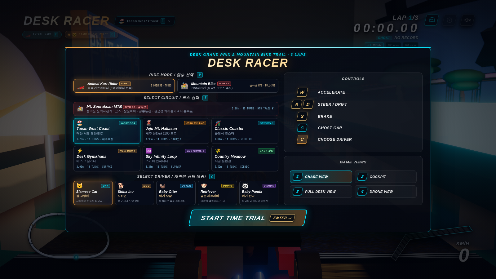
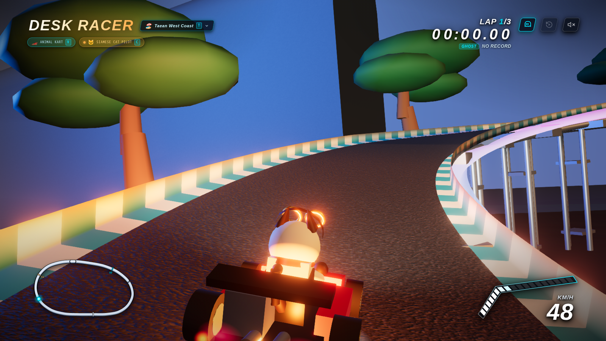
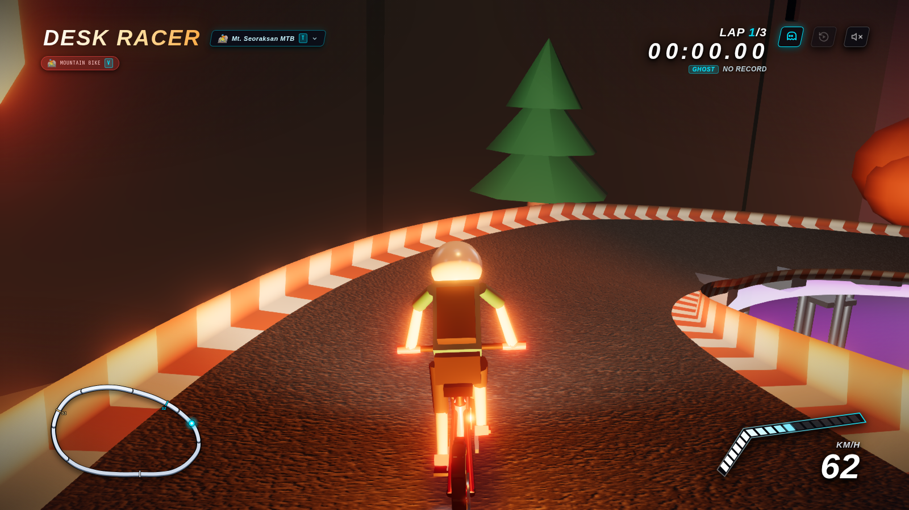
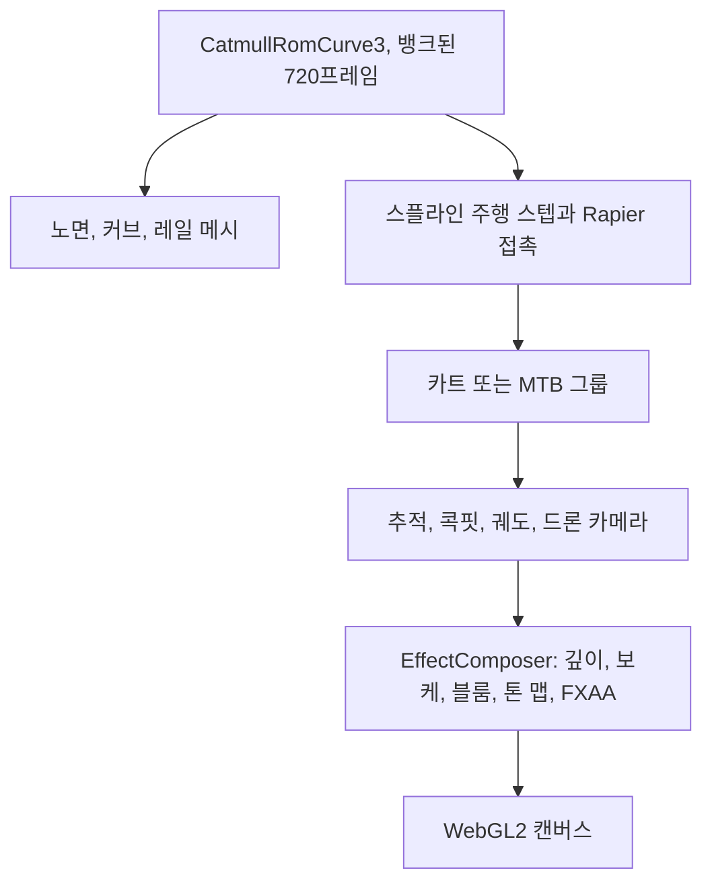

# Desk Racer

[English](README.md) · [한국어](README.ko.md)

**Three.js**와 **WebGL2**로 그리는 브라우저 타임 트라이얼입니다. 1:87 샴 고양이 카트, 또는 산악자전거로 닫힌 스플라인 서킷을 탑니다. 야간 책상 디오라마, 태안 서해안, 설악산, 한라산이 있습니다. 풍경 트랙과 차량, 대부분의 소품은 JavaScript로 만든 절차적 메시입니다. CDN에 닿을 때만 Vite 프록시로 선택적 GLB를 받습니다.

화면 제목은 **Desk Racer**입니다. 패키지 이름은 `desk-racer`입니다.

## 실행 화면

`npm run dev`로 띄운 앱에서 찍은 세 장입니다. 첫 장은 이미 렌더 중인 WebGL 화면 위의 시작 오버레이이고, 나머지 둘은 타임 트라이얼 중 추적 카메라입니다.

### 시작 화면

주행, 서킷, 드라이버 선택이 뒤에서 이미 그려지고 있는 씬 위에 올라갑니다.



### 태안 서해안 — 카트 추적

해안 소나무, 셰브론 커브, 미니맵, 샴 고양이 카트. 카메라 1은 1:87 차체 뒤 약 15 mm를 따라갑니다.



### 설악산 — 산악자전거 추적

같은 추적 리그를 설악산 MTB 서킷에 얹은 장면입니다. 주황 발광은 라이더의 드리프트·부스트 빛입니다.



## 3D JavaScript

레이스는 한 페이지입니다. HUD는 `index.html`, 프레임 루프는 `src/main.js`입니다. React는 의존성에 있지만 씬을 소유하지 않습니다.

### 스케일과 씬 그래프

월드 단위는 미터입니다. 카트 메시는 1:87 HO 차체, 약 18 × 12 × 8 mm이고, `0.38` 스케일로 그립니다. 추적 리그는 1:150 로우 체이스입니다. 차체 뒤 약 15.4 mm, 위 7.4 mm, 시야각 41.5°. 원근 투영 근평면은 2 mm라서 매크로 샷에서 차체가 잘리지 않습니다.

`WebGLRenderer`는 ACES Filmic 톤 매핑과 PCF 소프트 섀도를 씁니다. PMREM `RoomEnvironment`가 이미지 기반 조명을 넣습니다. 풍경 서킷은 그 위에 자체 태양, 하늘, 안개를 올립니다.

### 후처리

표시되는 프레임마다 `EffectComposer`가 다음 순서로 돕니다.

1. 하드웨어 깊이 텍스처를 쓰는 `RenderPass`
2. 커스텀 보케 패스 (48탭 황금각 Vogel 나선, `DEPTH_PACKING = 0`, 전경 샘플은 버림)
3. `UnrealBloomPass` (강도 `0.06`, 반경 `0.22`, 임계값 `1.15` — LED와 불씨만 번짐)
4. 톤 매핑용 `OutputPass`
5. FXAA

기본 피사계 심도 강도는 `0.35`입니다. `?dof=0`은 조리개를 닫지만, 셰이더는 깊이를 한 번 읽습니다. `?screenshot=1`은 두 프레임을 그린 뒤 `document.body.id = "screenshot-ready"`를 세우고 `requestAnimationFrame`을 멈춥니다. 헤드리스 캡처가 보케 readback에서 멈추지 않게 하기 위해서입니다.

### 스플라인, 메시, 머티리얼

각 서킷은 닫힌 구심 `THREE.CatmullRomCurve3`입니다. `src/scene/TrackRegistry.js`가 720프레임으로 샘플합니다. 접선 주위 쿼터니언이 노면을 뱅크합니다. 그 프레임으로 `CoasterTrackBuilder.js`가 아스팔트, 셰브론 커브, 레일, 터널 구간을 압출합니다.

풍경도 내려받은 월드 메시가 아니라 JavaScript입니다.

| 서킷 | 빌더 |
| --- | --- |
| 태안 서해안 | `TaeanCoastSceneryBuilder.js` |
| 설악산 MTB | `SeoraksanMtbSceneryBuilder.js` |
| 한라산 | `JejuHallasanSceneryBuilder.js` |
| 야간 책상, 짐카나, 인피니티, 컨트리사이드 | `DeskDioramaBuilder.js`와 트랙별 소품 |

`ProceduralTextures.js`는 `CanvasTexture`에 알베도, 러프니스, 노멀을 그립니다 (나무, 아스팔트, 니트, 털, 물). `GoldenHourAtmosphere.js`는 야외 서킷의 태양과 안개를 놓습니다. 드리프트 스파크와 고스트 홀로그램은 별도 메시입니다 (`KartDriftParticleSystem.js`, `GhostKartBuilder.js`).

선택 GLB (`desk_props`, `track_coaster`, `kart_1to87`, `room_environment`)는 `www.gstatic.com`이 응답할 때 클래식 책상 씬에서 우선합니다. 프록시가 실패해도 절차적 빌더가 씬을 채웁니다.

### 카메라와 차량

`src/main.js`의 `setCameraMode`:

| 키 | 모드 | 동작 |
| --- | --- | --- |
| `1` | 추적 | 레이싱 HUD. 시선은 차체에 고정. |
| `2` | 콕핏 | 같은 HUD, 카메라는 차체 안. |
| `3` | 책상 궤도 | 디오라마 전체를 `OrbitControls`로. HUD는 숨김. |
| `4` | 드론 | 스플라인 위를 자유롭게 따라감. HUD는 숨김. |

다섯 동물 드라이버는 `CharacterDriverBuilder.js`에서 만듭니다. 샴 고양이, 시바견, 아기 수달, 골든 리트리버, 아기 판다. `V`는 카트를 `MountainBikeBuilder.js`의 절차적 산악자전거로 바꿉니다. `G`는 `GhostSystem.js`의 반투명 고스트 리플레이를 켭니다.

### 주행 모델

자유 강체 자동차가 아닙니다. `KartPhysicsController.js`는 정적 책상과 트라이메시 접촉용 Rapier 월드를 두고, 차량은 키네마틱 바디입니다. 매 스텝에서 라이더를 스플라인에 투영하고, 가속·브레이크·조향을 적용한 뒤 그 포즈를 Three.js 그룹에 씁니다.

HUD 속도는 초당 미터가 아니라 표시용 스케일입니다.

```text
km/h = round(|speed| * 102.35 * 3.6)
```

스플라인 위 약 `0.204` m/s가 `75` km/h로 읽힙니다. 트랙과 차량 선택은 `localStorage`에 남습니다 (`desk_racer_active_track`, `desk_racer_vehicle_mode`, `desk_racer_active_character`). 저장된 트랙이 없거나 `classic`이면 시작 시 태안을 고릅니다.



## 플레이

```bash
npm install
npm run dev
```

출력된 로컬 URL을 엽니다. `Enter`로 고른 주행을 시작합니다. 프로덕션 빌드:

```bash
npm run build
npm run preview
```

`vite.config.ts`는 `/proxy-glb/*`를 gstatic CDN으로 프록시하고, 빌드 때 그 GLB를 `public/assets/models/`로 받습니다. 풍경 서킷은 이 다운로드에 의존하지 않습니다.

### 조작

| 키 | 동작 |
| --- | --- |
| `Enter` 또는 `Space` | 시작, 또는 런치 화면 닫기 |
| `W` `A` `S` `D` 또는 화살표 | 가속, 브레이크, 조향 |
| `1`–`4` | 추적, 콕핏, 책상 궤도, 드론 (`6`도 드론) |
| `C` | 다음 드라이버 |
| `V` | 카트 / 산악자전거 |
| `T` | 다음 서킷 |
| `R` | 스타트 라인으로 리셋 |
| `P` | 오토파일럿 |
| `G` | 고스트 리플레이 |
| `B` | 마지막 랩 리플레이 |
| `M` | 음소거 |
| `Esc` | 대화상자 또는 설정 팝오버 닫기 |

### 서킷

| Id | 주행 |
| --- | --- |
| `taean` | 서해안 타임 트라이얼. 저장된 값이 없을 때의 기본. |
| `seoraksan` | 산악자전거 트레일. |
| `hallasan` | 한라산 풍경 루프. |
| `classic` | 야간 책상 코스터. |
| `gymkhana` | 좁은 책상 레이아웃. |
| `infinity` | 8자 책상 레이아웃. |
| `countryside` | 긴 책상 레이아웃. |

### 유용한 쿼리

`?cam=1` … `?cam=4`는 카메라를 고릅니다. `?sector=1` … `?sector=6`은 스플라인 중간에서 시작합니다. `?sparks=1`은 오토파일럿, 드리프트, 부스트를 켭니다. `?dof=0`은 보케를 끕니다. `?screenshot=1`은 폰트와 선택 GLB를 기다린 뒤 두 프레임을 그리고 루프를 멈춥니다.

## 레이아웃

```text
index.html                         HUD, 시작 대화상자, 도움말
src/main.js                        렌더러, 카메라, 컴포저, 프레임 루프
src/physics/KartPhysicsController.js   Rapier 월드와 스플라인 주행 스텝
src/scene/TrackRegistry.js         닫힌 스플라인 일곱 개
src/scene/CoasterTrackBuilder.js   압출 노면, 커브, 레일
src/scene/ProceduralTextures.js    캔버스 PBR 맵
src/scene/*SceneryBuilder.js       태안, 설악산, 한라산 풍경
src/scene/CharacterDriverBuilder.js    동물 드라이버 다섯
src/scene/MountainBikeBuilder.js   절차적 MTB
src/ghost/GhostSystem.js           랩 고스트
public/assets/                   오디오, 아이콘, 선택 GLB
```

## 스택

- [Three.js](https://threejs.org/) `0.183` — 씬 그래프, 스플라인, 후처리
- [Rapier](https://rapier.rs/) `0.19` (`@dimforge/rapier3d-compat`) — 정적 접촉
- [Vite](https://vitejs.dev/) `6` — 개발 서버, GLB 프록시, 프로덕션 빌드
- Node.js 18+
