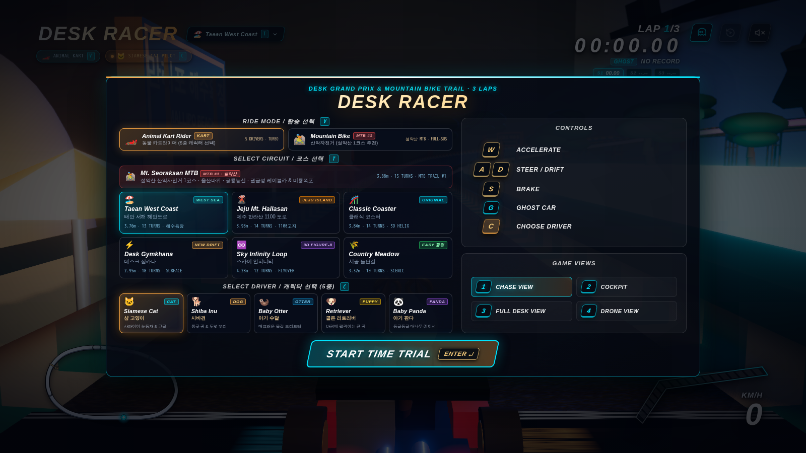
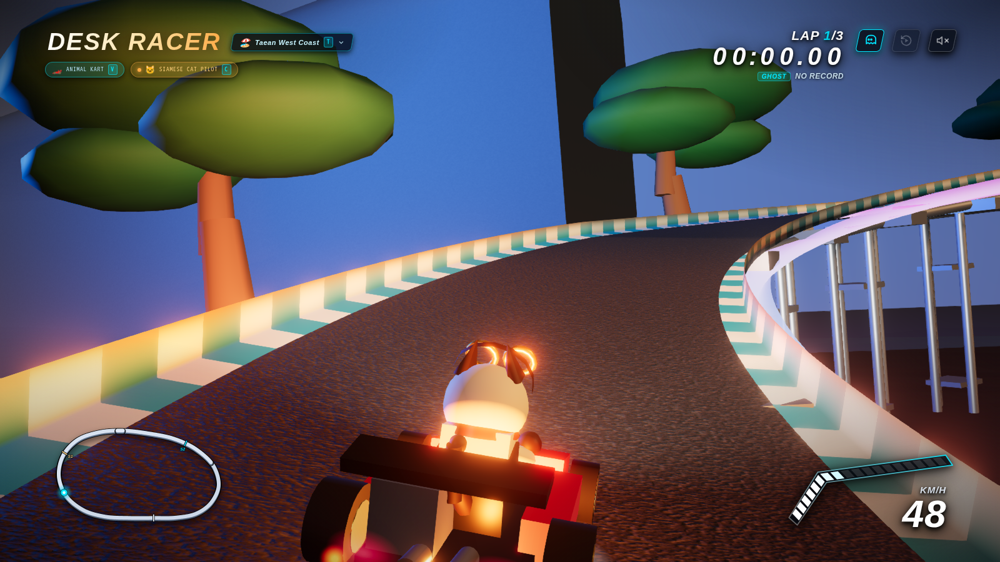
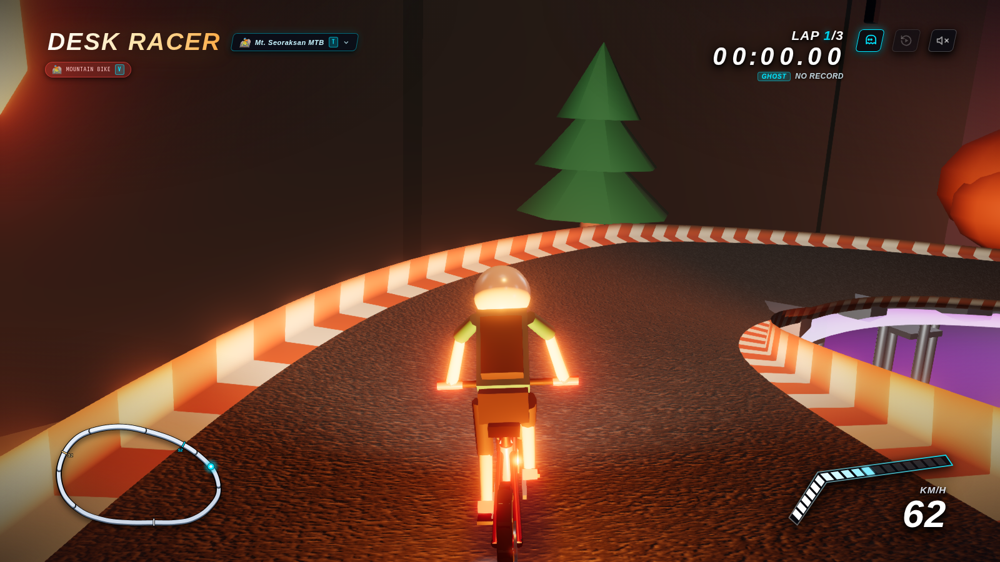
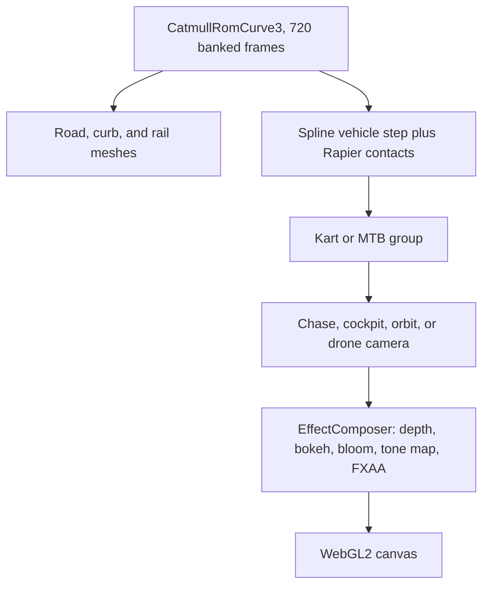

# Desk Racer

[English](README.md) · [한국어](README.ko.md)

> **▶ [Play the live demo](https://edumgt.github.io/Siamese-Cat-KartRider/)** — Race a Siamese-cat kart or mountain bike directly in your browser.
>
> Enjoyed the race? Please give the project a ⭐ **Star** — it helps others discover the demo.

A browser time trial rendered with **Three.js** and **WebGL2**. You race a 1:87 Siamese-cat kart, or a mountain bike, on closed spline circuits: a night desk diorama, the Taean west coast, Mt. Seoraksan, and Hallasan. Scenic tracks, vehicles, and most props are procedural JavaScript meshes. Optional GLBs load through a Vite proxy when the CDN is reachable.

The on-screen title is **Desk Racer**. The package name is `desk-racer`.

## Screens

Three frames from the running app (`npm run dev`). The first is the launch overlay on the live WebGL view. The other two are chase cameras during a time trial.

### Launch

Ride, circuit, and driver selection sit on top of the scene that is already rendering behind the dialog.



### Taean west coast — kart chase

Coastal pines, chevron curbs, and the minimap around a Siamese-cat kart. Camera 1 follows about 15 mm behind the 1:87 body.



### Mt. Seoraksan — mountain bike chase

The same chase rig on the Seoraksan MTB circuit. Orange emissive light is the drift / boost glow on the rider.



## 3D JavaScript

The race is one page: `index.html` for the HUD, `src/main.js` for the frame loop. React is a dependency but does not own the scene.

### Scale and the scene graph

World units are meters. The kart mesh is a 1:87 HO body, about 18 × 12 × 8 mm, drawn at scale `0.38`. The chase rig is the low 1:150 camera: about 15.4 mm behind, 7.4 mm up, 41.5° FOV. The perspective near plane is 2 mm so the macro shot does not clip the shell.

`WebGLRenderer` uses ACES Filmic tone mapping and PCF soft shadows. A PMREM `RoomEnvironment` supplies image-based lighting. Scenic circuits add their own sun, sky, and fog on top of that rig.

### Post-processing

`EffectComposer` runs every presented frame:

1. `RenderPass` with a hardware depth texture
2. A custom bokeh pass (48-tap golden-angle Vogel spiral, `DEPTH_PACKING = 0`, foreground samples rejected)
3. `UnrealBloomPass` (strength `0.06`, radius `0.22`, threshold `1.15` so only LEDs and embers bloom)
4. `OutputPass` for tone mapping
5. FXAA

Default depth-of-field strength is `0.35`. `?dof=0` closes the aperture; the shader still reads depth once. `?screenshot=1` renders two frames, sets `document.body.id = "screenshot-ready"`, and stops `requestAnimationFrame` so a headless capture does not stall on the bokeh readback.

### Splines, meshes, and materials

Each circuit is a closed centripetal `THREE.CatmullRomCurve3`, sampled into 720 frames in `src/scene/TrackRegistry.js`. A quaternion around the tangent banks the road. Those frames extrude the asphalt, chevron curbs, rails, and tunnel segments in `CoasterTrackBuilder.js`.

Scenic dressing is also JavaScript, not a downloaded world mesh:

| Circuit | Builder |
| --- | --- |
| Taean west coast | `TaeanCoastSceneryBuilder.js` |
| Mt. Seoraksan MTB | `SeoraksanMtbSceneryBuilder.js` |
| Hallasan | `JejuHallasanSceneryBuilder.js` |
| Night desk, gymkhana, infinity, countryside | `DeskDioramaBuilder.js` plus track-specific props |

`ProceduralTextures.js` paints albedo, roughness, and normal maps on `CanvasTexture` (wood, asphalt, knit, fur, water). `GoldenHourAtmosphere.js` places the sun and fog for the outdoor circuits. Drift sparks and the ghost hologram are their own mesh systems (`KartDriftParticleSystem.js`, `GhostKartBuilder.js`).

Optional GLBs (`desk_props`, `track_coaster`, `kart_1to87`, `room_environment`) are preferred for the classic desk when `www.gstatic.com` answers. The procedural builders always cover the scene if the proxy fails.

### Cameras and vehicles

`setCameraMode` in `src/main.js`:

| Key | Mode | What it does |
| --- | --- | --- |
| `1` | Chase | Racing HUD. Look-at stays on the body. |
| `2` | Cockpit | Same HUD, camera inside the shell. |
| `3` | Desk orbit | `OrbitControls` over the whole diorama. HUD hides. |
| `4` | Drone | Free follow above the spline. HUD hides. |

Five animal drivers are built in `CharacterDriverBuilder.js`: Siamese Cat, Shiba Inu, Baby Otter, Golden Retriever, and Baby Panda. `V` swaps the kart for the procedural mountain bike in `MountainBikeBuilder.js`. `G` toggles a translucent ghost replay from `GhostSystem.js`.

### Driving model

This is not a free rigid-body car. `KartPhysicsController.js` keeps a Rapier world for the static desk and trimesh contacts, and a kinematic body for the vehicle. Each step projects the rider onto the spline, applies throttle, brake, and steer, then writes the resulting pose back to the Three.js group.

HUD speed is display scale, not raw meters per second:

```text
km/h = round(|speed| * 102.35 * 3.6)
```

About `0.204` m/s on the spline reads as `75` km/h. Track and vehicle choices persist in `localStorage` (`desk_racer_active_track`, `desk_racer_vehicle_mode`, `desk_racer_active_character`). If the stored track is missing or `classic`, startup selects Taean.



## Play

```bash
npm install
npm run dev
```

Open the printed local URL. `Enter` starts the selected ride. Production build:

```bash
npm run build
npm run preview
```

`vite.config.ts` proxies `/proxy-glb/*` to the gstatic CDN and fetches those GLBs at build time into `public/assets/models/`. Scenic circuits do not depend on that fetch.

### Controls

| Key | Action |
| --- | --- |
| `Enter` or `Space` | Start or dismiss the launch screen |
| `W` `A` `S` `D` or arrows | Throttle, brake, steer |
| `1`–`4` | Chase, cockpit, desk orbit, drone (`6` also selects drone) |
| `C` | Next driver |
| `V` | Kart / mountain bike |
| `T` | Next circuit |
| `R` | Reset to the start line |
| `P` | Autopilot |
| `G` | Ghost replay |
| `B` | Replay the last lap |
| `M` | Mute |
| `Esc` | Close dialogs, or the settings popover |

### Circuits

| Id | Ride |
| --- | --- |
| `taean` | West-coast time trial. Default when nothing is stored. |
| `seoraksan` | Mountain-bike trail. |
| `hallasan` | Hallasan scenic loop. |
| `classic` | Night desk coaster. |
| `gymkhana` | Tight desk layout. |
| `infinity` | Figure-eight desk layout. |
| `countryside` | Longer desk layout. |

### Useful query flags

`?cam=1` … `?cam=4` picks a camera. `?sector=1` … `?sector=6` starts part-way along the spline. `?sparks=1` enables autopilot, drift, and boost. `?dof=0` disables bokeh. `?screenshot=1` waits for fonts and optional GLBs, renders two frames, and stops the loop.

## Layout

```text
index.html                         HUD, launch dialog, help
src/main.js                        renderer, cameras, composer, frame loop
src/physics/KartPhysicsController.js   Rapier world and spline vehicle step
src/scene/TrackRegistry.js         seven closed splines
src/scene/CoasterTrackBuilder.js   extruded road, curbs, rails
src/scene/ProceduralTextures.js    canvas PBR maps
src/scene/*SceneryBuilder.js       Taean, Seoraksan, Hallasan dressing
src/scene/CharacterDriverBuilder.js    five animal drivers
src/scene/MountainBikeBuilder.js   procedural MTB
src/ghost/GhostSystem.js           lap ghost
public/assets/                   audio, icons, optional GLBs
```

## Stack

- [Three.js](https://threejs.org/) `0.183` — scene graph, splines, post-processing
- [Rapier](https://rapier.rs/) `0.19` (`@dimforge/rapier3d-compat`) — static contacts
- [Vite](https://vitejs.dev/) `6` — dev server, GLB proxy, production build
- Node.js 18+
